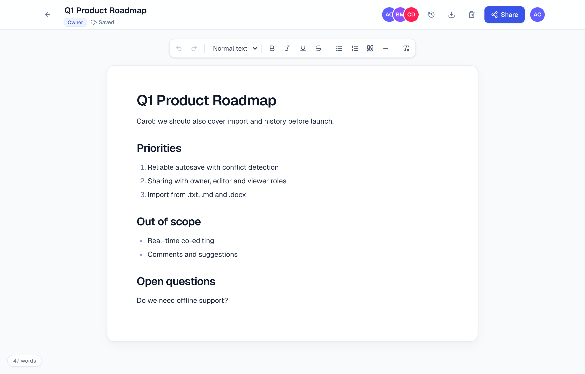

# Ajaia Docs

A lightweight collaborative document editor: create and edit rich-text documents, import files, and share them with other users as editors or viewers.

**Live demo:** https://ajaia-docs-ecru-xi.vercel.app (accounts below)



## Demo accounts

All accounts use the password **`ajaia-demo`**. The login page also has one-click buttons for each account.

| User | Email | In the seeded "Welcome to Ajaia Docs" document |
|---|---|---|
| Alice Chen | `alice@ajaia.dev` | Owner |
| Bob Martin | `bob@ajaia.dev` | Editor |
| Carol Diaz | `carol@ajaia.dev` | Viewer (read-only) |

Users and the welcome document are created automatically the first time the app connects to an empty database.

## Features

- **Documents:** create, rename (click the title), edit, delete (owner only), reopen from the dashboard.
- **Rich text:** bold, italic, underline, strikethrough, headings H1–H3, bulleted and numbered lists, quotes, undo/redo. Standard shortcuts work (`Ctrl/Cmd+B/I/U`, Markdown-style `# `, `- `, `1. `).
- **Autosave:** changes save automatically after 0.8 s of inactivity (`Ctrl/Cmd+S` saves immediately). The status shows *Unsaved / Saving / All changes saved*. Saves are versioned: if someone else saved a newer version, the stale write is rejected (HTTP 409) and the user is asked to reload instead of silently overwriting.
- **File import:** **`.txt`, `.md`, `.docx` only, max 2 MB.** Each file becomes a new editable document with headings, emphasis and lists preserved. Other types are rejected with a clear message.
- **Sharing:** the owner shares by email as *Can edit* or *Can view*, changes roles, or revokes access. The dashboard separates **My documents** and **Shared with me**. Viewers get a read-only editor and the API rejects their writes.
- **Version history:** a side panel lists saved versions with author and time. Consecutive saves by the same person within 5 minutes are grouped into one entry. Click an entry to preview it read-only, and (editors and owners) restore it. A restore is itself recorded, so it can be undone.
- **Dashboard:** document cards with a text preview, search by title or owner, and drag-and-drop import.
- **Export:** download any readable document as Markdown.

## Tech stack

Next.js 15 (App Router, TypeScript) · TipTap 3 (ProseMirror) · MongoDB (official driver) · Zod · jose (JWT session cookie) · Tailwind CSS 4 · lucide icons · Vitest · Playwright.

## Run locally

Requirements: Node.js 20+ and a MongoDB instance (local Docker or a free MongoDB Atlas cluster).

```bash
# 1. Start MongoDB (skip if you use Atlas)
docker run -d --name ajaia-mongo -p 27017:27017 mongo:7

# 2. Configure
cp .env.example .env.local
# set SESSION_SECRET to 32+ random characters, e.g.: openssl rand -base64 32

# 3. Install and run
npm install
npm run dev            # http://localhost:3000
```

| Variable | Required | Description |
|---|---|---|
| `MONGODB_URI` | yes | MongoDB connection string |
| `MONGODB_DB` | no | Database name (default `ajaia_docs`) |
| `SESSION_SECRET` | yes | 32+ characters used to sign session cookies |

## Tests

```bash
npm run typecheck && npm run lint

# Unit + integration (integration tests run when TEST_MONGODB_URI is set; they use a throwaway database)
TEST_MONGODB_URI=mongodb://localhost:27017 npm test

# End-to-end (builds are served with `npm run start`; run `npm run build` first)
npx playwright install chromium
npm run test:e2e
```

What is covered:

- `tests/unit/access.test.ts`: role resolution and permission rules.
- `tests/unit/import.test.ts`: `.txt`, `.md` (including script stripping), `.docx` conversion, and rejection of unsupported, empty, binary and oversized files.
- `tests/unit/markdown.test.ts`: Markdown export.
- `tests/unit/documents.test.ts`: the document service against a real MongoDB: owner/editor/viewer/no-access rules, revoking access, stale write rejection (409), input validation, history grouping and restore permissions.
- `tests/e2e/core-flow.spec.ts`: in a real browser: sign in, create, format, autosave, reload and verify formatting, share as viewer, sign in as the recipient, see it under *Shared with me*, read-only editor; importing a Markdown file; and restoring another user's earlier version from history.

CI (`.github/workflows/ci.yml`) runs all of the above against a MongoDB service container.

## Deploy (Vercel + MongoDB Atlas, both free tiers)

1. Create a free Atlas cluster and allow network access from `0.0.0.0/0` (Vercel has no fixed IPs).
2. Import the repository in Vercel (framework preset: Next.js, no build overrides).
3. Set `MONGODB_URI`, `MONGODB_DB` and `SESSION_SECRET` in the Vercel project's environment variables and deploy.

The first request seeds the demo users and the welcome document.

## Project structure

```
src/
  app/                 pages and API route handlers
    api/documents/     CRUD, sharing, import, export
  components/          editor workspace, toolbar, share dialog, dashboard
  lib/
    documents.ts       document service (all access checks live here)
    revisions.ts       version history: grouping, preview, restore
    access.ts          role rules + MongoDB access filters
    import.ts          file -> sanitized HTML -> editor JSON
    editor/            shared TipTap schema, validation, Markdown export
    db.ts, session.ts  MongoDB connection + seeding, cookie sessions
tests/                 unit, integration and e2e tests
docs/screenshots/      screenshots of the main flows
```

See [ARCHITECTURE.md](ARCHITECTURE.md) for design decisions and [AI_WORKFLOW.md](AI_WORKFLOW.md) for how AI tools were used.
